# IntelliView — Backend System Architecture

> A comprehensive architectural breakdown of the IntelliView backend: a Node.js/Express platform powering real-time coding interviews, AI-assisted practice, and competitive coding portfolio analytics.

---

## 1. High-Level Architecture Overview

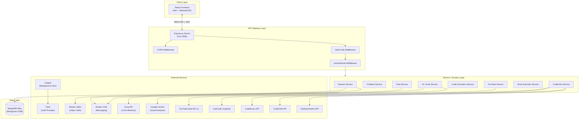

---

## 2. Layer-by-Layer Breakdown

### 2.1 Entry Point & Server Bootstrap

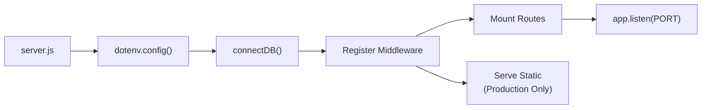

| File | Purpose |
|------|---------|
| [server.js](file:///d:/project/IntelliView/backend/src/server.js) | Application entry point — bootstraps Express, connects to MongoDB, registers all middleware and routes |
| [env.js](file:///d:/project/IntelliView/backend/src/lib/env.js) | Centralised environment variable accessor (PORT, DB_URL, NODE_ENV, keys) |
| [db.js](file:///d:/project/IntelliView/backend/src/lib/db.js) | Mongoose connection to MongoDB Atlas with graceful exit on failure |

---

### 2.2 Middleware Pipeline

Every incoming request passes through this pipeline:

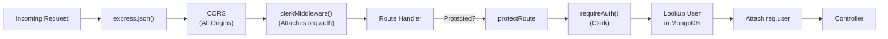

| Middleware | File | Description |
|------------|------|-------------|
| `express.json()` | Built-in | Parses JSON request bodies |
| `cors()` | Built-in | Currently allows all origins for dev flexibility |
| `clerkMiddleware()` | [server.js#L37](file:///d:/project/IntelliView/backend/src/server.js#L37) | Attaches `req.auth()` with Clerk session data |
| `protectRoute` | [protectRoute.js](file:///d:/project/IntelliView/backend/src/middleware/protectRoute.js) | Composed middleware: `requireAuth()` → DB user lookup → `req.user` attachment |

> [!IMPORTANT]
> The `protectRoute` middleware is a **two-step composed array**: first Clerk's `requireAuth()` validates the JWT, then a custom function resolves the Clerk ID to a MongoDB User document and attaches it as `req.user`.

---

### 2.3 Route Registry

All routes are mounted on the Express app in [server.js](file:///d:/project/IntelliView/backend/src/server.js):

| Prefix | Route File | Auth | Domain |
|--------|-----------|------|--------|
| `/api/inngest` | Inngest Serve | — | Webhook handler for Inngest events |
| `/api/chat` | [chatRoutes.js](file:///d:/project/IntelliView/backend/src/routes/chatRoutes.js) | ✅ Protected | Stream chat token generation |
| `/api/sessions` | [sessionRoutes.js](file:///d:/project/IntelliView/backend/src/routes/sessionRoutes.js) | ✅ Protected | Live interview room management |
| `/api/problems` | [problemRoutes.js](file:///d:/project/IntelliView/backend/src/routes/problemRoutes.js) | Mixed | Coding problem CRUD |
| `/api/youtube` | [youtubeRoutes.js](file:///d:/project/IntelliView/backend/src/routes/youtubeRoutes.js) | ❌ Public | YouTube video search proxy |
| `/api/grok` | [grok.js](file:///d:/project/IntelliView/backend/routes/grok.js) | ❌ Public | AI hints, problem generation, interview Q&A |
| `/api/codefolio` | [codefolioRoutes.js](file:///d:/project/IntelliView/backend/src/routes/codefolioRoutes.js) | Mixed | Coding platform stats aggregation |
| `/api/interview` | [interviewRoutes.js](file:///d:/project/IntelliView/backend/src/routes/interviewRoutes.js) | ✅ Protected | Mock interview history & reports |
| `/api/execute` | [executeRoutes.js](file:///d:/project/IntelliView/backend/routes/executeRoutes.js) | ❌ Public | Local code execution engine |

> [!NOTE]
> Two route files (`grok.js`, `executeRoutes.js`) live in `backend/routes/` (outside `src/`), while the rest live in `backend/src/routes/`. This is an inconsistency worth noting.

---

## 3. Domain Services — Detailed Architecture

### 3.1 Authentication & User Management

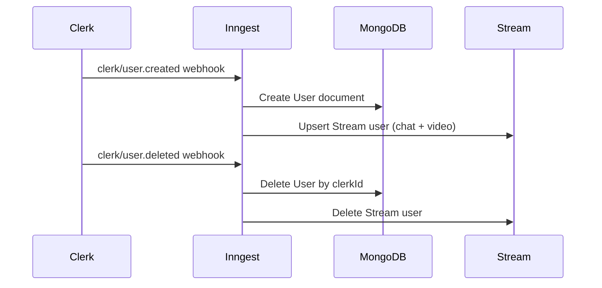

| Component | Details |
|-----------|---------|
| **Auth Provider** | [Clerk](https://clerk.com) — handles signup, login, session tokens, JWT verification |
| **User Sync** | [inngest.js](file:///d:/project/IntelliView/backend/src/lib/inngest.js) — Inngest functions react to Clerk webhooks to sync users to MongoDB + Stream |
| **User Model** | [User.js](file:///d:/project/IntelliView/backend/src/models/User.js) — `name`, `email`, `profileImage`, `clerkId`, `codefolioUsernames` |

**Data Flow:**
1. User signs up via Clerk on frontend
2. Clerk fires `clerk/user.created` webhook → Inngest endpoint
3. Inngest function creates MongoDB User + Stream user
4. On deletion, reverse sync cleans up both stores

---

### 3.2 Live Interview Session System

```mermaid
flowchart TB
    subgraph Create["Create Session"]
        C1["POST /api/sessions"] --> C2["Validate input"]
        C2 --> C3["Check no active session"]
        C3 --> C4["Generate callId + sessionCode"]
        C4 --> C5["Save Session to MongoDB"]
        C5 --> C6["Create Stream Video Call"]
        C6 --> C7["Create Stream Chat Channel"]
    end

    subgraph Join["Join Session"]
        J1["POST /api/sessions/:id/join<br/>POST /api/sessions/join/code/:code"] --> J2["Validate session active"]
        J2 --> J3["Check not host"]
        J3 --> J4["Check not full (max 2)"]
        J4 --> J5["Set participant"]
        J5 --> J6["Add to Stream Chat"]
    end

    subgraph End["End Session"]
        E1["POST /api/sessions/:id/end"] --> E2["Verify host"]
        E2 --> E3["Delete Stream Video Call"]
        E3 --> E4["Delete Stream Chat Channel"]
        E4 --> E5["Mark status = completed"]
    end
```

| Resource | Endpoint | Method | Auth |
|----------|----------|--------|------|
| Create session | `/api/sessions` | POST | ✅ |
| Active sessions count | `/api/sessions/active` | GET | ✅ |
| My active sessions | `/api/sessions/my-active` | GET | ✅ |
| My recent sessions | `/api/sessions/my-recent` | GET | ✅ |
| Join by code | `/api/sessions/join/code/:code` | POST | ✅ |
| Get session | `/api/sessions/:id` | GET | ✅ |
| Join session | `/api/sessions/:id/join` | POST | ✅ |
| Leave session | `/api/sessions/:id/leave` | POST | ✅ |
| End session | `/api/sessions/:id/end` | POST | ✅ |

**Key Design Decisions:**
- Sessions have a strict **2-participant limit** (host + 1 participant)
- Each session generates a unique **8-character alphanumeric code** for easy sharing
- Stream Video + Chat are created/destroyed with the session lifecycle
- Only the **host** can end a session; only **participants** can leave

**Session Model** ([Session.js](file:///d:/project/IntelliView/backend/src/models/Session.js)):
- `problem` (String), `difficulty` (enum), `host` (User ref), `participant` (User ref), `status` (active/completed), `callId` (Stream), `sessionCode` (unique index)

---

### 3.3 Coding Problem System

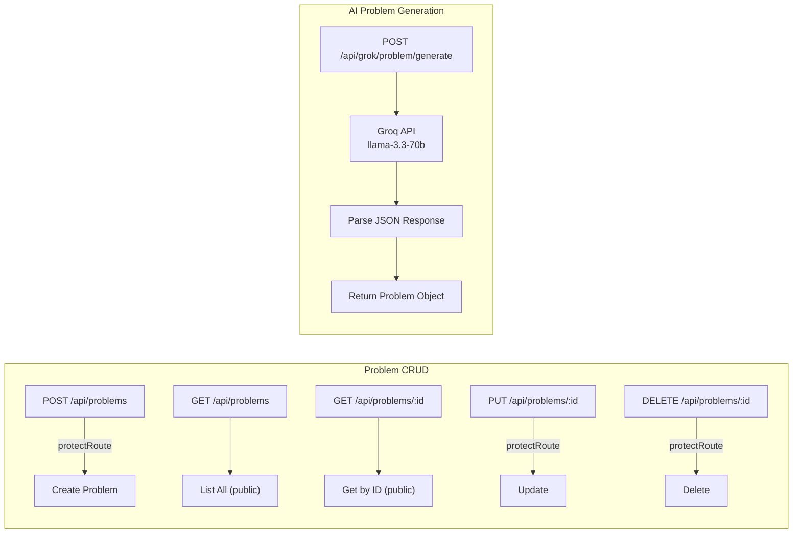

**Problem Model** ([Problem.js](file:///d:/project/IntelliView/backend/src/models/Problem.js)):

| Field | Type | Description |
|-------|------|-------------|
| `id` | String (unique) | Custom problem identifier |
| `title` | String | Display title |
| `difficulty` | Enum: Easy/Medium/Hard | Difficulty level |
| `category` | String | Topic category |
| `description` | `{ text, notes[] }` | Problem statement |
| `examples` | Array of `{ input, output, explanation }` | Sample test cases |
| `constraints` | String[] | Problem constraints |
| `starterCode` | `{ python, java, cpp }` | Per-language starter code |
| `expectedOutput` | `{ python, java, cpp }` | Per-language expected output |
| `createdBy` | User ObjectId | Author reference |

---

### 3.4 Code Execution Engine

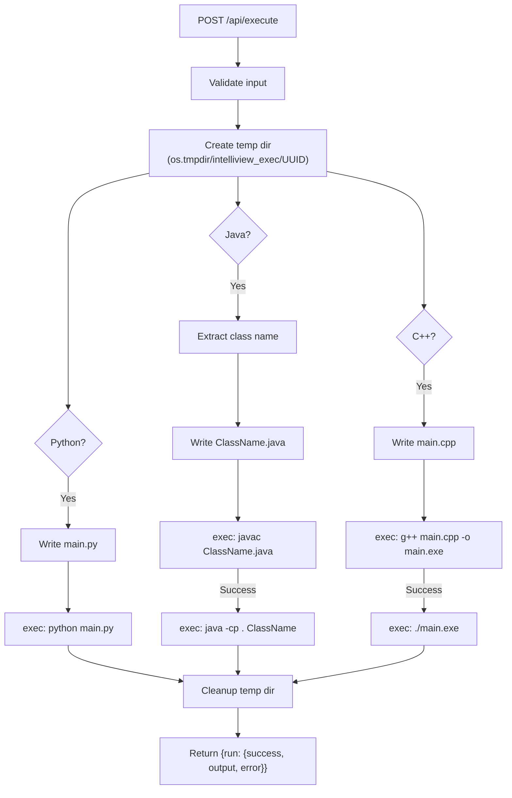

> [!WARNING]
> The code execution engine uses `child_process.exec()` directly on the server. This is a **significant security concern** in production — arbitrary code execution without sandboxing. A containerised execution environment (e.g., Docker, Firecracker) is strongly recommended.

**Features:**
- **15-second timeout** on all executions
- **Compiler availability check** via `GET /api/execute/compilers`
- Supports **Python, Java, C++**
- Temporary files are cleaned up in `finally` block

---

### 3.5 AI Services (Grok/Groq + Gemini)

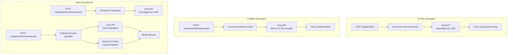

| Endpoint | AI Model | Purpose |
|----------|----------|---------|
| `POST /api/grok/hint` | `openai/gpt-oss-120b` (Groq) | Generate 3 progressive coding hints |
| `POST /api/grok/problem/generate` | `llama-3.3-70b-versatile` (Groq) | Generate complete coding problems |
| `POST /api/grok/interview/questions` | `openai/gpt-oss-120b` (Groq) | Generate interview questions with ideal answers |
| `POST /api/grok/interview/evaluate` | `openai/gpt-oss-120b` (Groq) + `gemini-2.5-flash` (Google) | Evaluate answers + visual analysis of video frames |

**Interview Evaluation — Dual AI Pipeline:**
1. **Groq** evaluates text answers → scores, feedback, strengths, improvements
2. **Gemini** (optional) analyses video frames → nervousness, eye contact, attire assessment
3. Results are merged via `Promise.all()` for parallel execution

---

### 3.6 Mock Interview Persistence

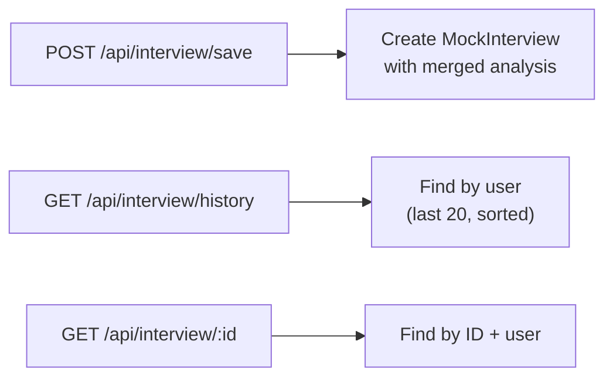

**MockInterview Model** ([MockInterview.js](file:///d:/project/IntelliView/backend/src/models/MockInterview.js)):

| Field | Type | Notes |
|-------|------|-------|
| `user` | User ObjectId | Owner |
| `topic`, `topicLabel` | String | Interview topic |
| `difficulty` | Enum | Easy/Medium/Hard |
| `questionCount` | Number | Total questions |
| `questions[]` | `{id, question, idealAnswer}` | Generated questions |
| `answers[]` | String[] | Candidate responses |
| `overallScore` | Number (0-100) | AI-evaluated score |
| `grade` | String | A+ through F |
| `summary` | String | Overall assessment |
| `strengths[]`, `areasToImprove[]` | String[] | Categorised feedback |
| `questionAnalysis[]` | Embedded schema | Per-question deep analysis |
| `visualAnalysis` | `{nervousness, eyeContact, attire, feedback}` | Gemini visual assessment |

---

### 3.7 CodeFolio — Multi-Platform Stats Aggregator

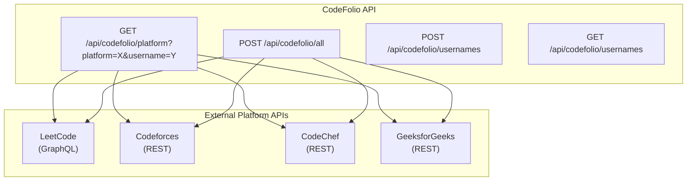

**Platform Integration Details:**

| Platform | API Type | Data Retrieved |
|----------|----------|---------------|
| **LeetCode** | GraphQL (`leetcode.com/graphql/`) | Solved problems (Easy/Medium/Hard), ranking, contest rating, badges, activity calendar, streak |
| **Codeforces** | REST (`codeforces.com/api/`) | Rating, max rating, rank, contests count, unique problems solved, active days |
| **CodeChef** | REST (placeholder) | Contest data (needs API key — currently a stub) |
| **GeeksforGeeks** | REST (placeholder) | Profile data (basic implementation) |

---

### 3.8 Real-Time Communication (Stream)

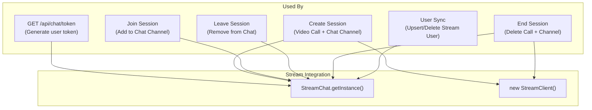

| Client | Purpose | Initialised In |
|--------|---------|---------------|
| `chatClient` (StreamChat) | Chat messaging, token generation, user management | [stream.js](file:///d:/project/IntelliView/backend/src/lib/stream.js) |
| `streamClient` (StreamClient) | Video call creation/deletion | [stream.js](file:///d:/project/IntelliView/backend/src/lib/stream.js) |

---

## 4. Data Model — Entity Relationship Diagram

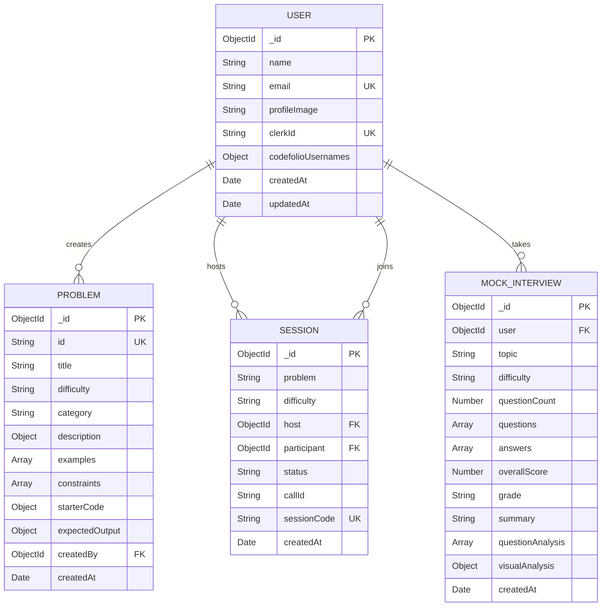

---

## 5. Complete API Endpoint Reference

### Authentication & Chat
| Method | Endpoint | Auth | Description |
|--------|----------|------|-------------|
| GET | `/api/chat/token` | ✅ | Get Stream chat/video token |

### Sessions (Live Interview Rooms)
| Method | Endpoint | Auth | Description |
|--------|----------|------|-------------|
| POST | `/api/sessions` | ✅ | Create a new interview session |
| GET | `/api/sessions/active` | ✅ | Get count of active sessions |
| GET | `/api/sessions/my-active` | ✅ | Get user's active sessions |
| GET | `/api/sessions/my-recent` | ✅ | Get user's completed sessions (last 20) |
| POST | `/api/sessions/join/code/:code` | ✅ | Join session via 8-char code |
| GET | `/api/sessions/:id` | ✅ | Get session details |
| POST | `/api/sessions/:id/join` | ✅ | Join session by ID |
| POST | `/api/sessions/:id/leave` | ✅ | Leave session (participant only) |
| POST | `/api/sessions/:id/end` | ✅ | End session (host only) |

### Problems (Coding Challenges)
| Method | Endpoint | Auth | Description |
|--------|----------|------|-------------|
| POST | `/api/problems` | ✅ | Create a new problem |
| GET | `/api/problems` | ❌ | List all problems |
| GET | `/api/problems/:id` | ❌ | Get problem by ID |
| PUT | `/api/problems/:id` | ✅ | Update a problem |
| DELETE | `/api/problems/:id` | ✅ | Delete a problem |

### AI Services
| Method | Endpoint | Auth | Description |
|--------|----------|------|-------------|
| POST | `/api/grok/hint` | ❌ | Generate 3 progressive coding hints |
| POST | `/api/grok/problem/generate` | ❌ | AI-generate a full problem |
| POST | `/api/grok/interview/questions` | ❌ | Generate interview questions |
| POST | `/api/grok/interview/evaluate` | ❌ | Evaluate interview with text + visual AI |

### Mock Interviews
| Method | Endpoint | Auth | Description |
|--------|----------|------|-------------|
| POST | `/api/interview/save` | ✅ | Save completed interview report |
| GET | `/api/interview/history` | ✅ | Get interview history (last 20) |
| GET | `/api/interview/:id` | ✅ | Get specific interview details |

### Code Execution
| Method | Endpoint | Auth | Description |
|--------|----------|------|-------------|
| GET | `/api/execute/compilers` | ❌ | Check available compilers |
| POST | `/api/execute` | ❌ | Execute code (Python/Java/C++) |

### CodeFolio
| Method | Endpoint | Auth | Description |
|--------|----------|------|-------------|
| GET | `/api/codefolio/platform` | ❌ | Get stats for one platform |
| POST | `/api/codefolio/all` | ❌ | Get stats for all platforms |
| POST | `/api/codefolio/usernames` | ✅ | Save platform usernames |
| GET | `/api/codefolio/usernames` | ✅ | Get saved usernames |

### YouTube
| Method | Endpoint | Auth | Description |
|--------|----------|------|-------------|
| GET | `/api/youtube/search?q=QUERY` | ❌ | Search YouTube videos (proxy) |

### Background Jobs (Inngest)
| Method | Endpoint | Auth | Description |
|--------|----------|------|-------------|
| POST | `/api/inngest` | Webhook | Inngest event handler (Clerk webhooks) |

---

## 6. External Service Dependency Map

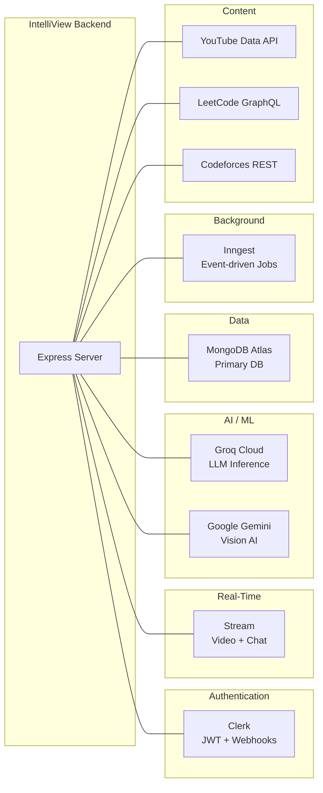

| Service | Purpose | Env Variables |
|---------|---------|---------------|
| **Clerk** | Authentication, user management, JWT | `CLERK_PUBLISHABLE_KEY`, `CLERK_SECRET_KEY` |
| **MongoDB Atlas** | Primary data store | `DB_URL` |
| **Stream** | Video calls + real-time chat | `STREAM_API_KEY`, `STREAM_API_SECRET` |
| **Inngest** | Background job orchestration | `INNGEST_EVENT_KEY`, `INNGEST_SIGNING_KEY` |
| **Groq** | LLM inference (hints, questions, evaluation) | `GROK_API_KEY` |
| **Google Gemini** | Vision AI (interview visual analysis) | `GEMINI_API_KEY` |
| **YouTube Data API** | Video solution search | `YOUTUBE_API_KEY` |
| **LeetCode** | Profile stats (GraphQL) | None (public API) |
| **Codeforces** | Profile stats (REST) | None (public API) |

---

## 7. Directory Structure

```
backend/
├── .env                          # Environment variables (secrets)
├── .env.example                  # Template for env vars
├── package.json                  # Dependencies & scripts
│
├── routes/                       # ⚠️ Legacy route location
│   ├── executeRoutes.js          # Code execution engine
│   └── grok.js                   # AI service routes (hints, generation, evaluation)
│
└── src/
    ├── server.js                 # Entry point — Express app bootstrap
    │
    ├── controllers/              # Business logic handlers
    │   ├── chatController.js     # Stream token generation
    │   ├── codefolioController.js # Multi-platform stats aggregation
    │   ├── interviewController.js # Mock interview report management
    │   ├── problemController.js  # Problem CRUD operations
    │   └── sessionController.js  # Live interview session lifecycle
    │
    ├── lib/                      # Shared utilities & integrations
    │   ├── codingPlatforms.js    # LeetCode, Codeforces, CodeChef, GFG API clients
    │   ├── db.js                 # MongoDB connection
    │   ├── env.js                # Centralised env config
    │   ├── inngest.js            # Background job definitions (user sync)
    │   └── stream.js             # Stream Chat + Video client initialisation
    │
    ├── middleware/                # Express middleware
    │   └── protectRoute.js       # Auth guard (Clerk + DB user lookup)
    │
    ├── models/                   # Mongoose schemas
    │   ├── MockInterview.js      # Interview reports with embedded analysis
    │   ├── Problem.js            # Coding problems with multi-language support
    │   ├── Session.js            # Live interview sessions
    │   └── User.js               # User profiles with platform usernames
    │
    └── routes/                   # Route definitions
        ├── chatRoutes.js         # /api/chat
        ├── codefolioRoutes.js    # /api/codefolio
        ├── interviewRoutes.js    # /api/interview
        ├── problemRoutes.js      # /api/problems
        ├── sessionRoutes.js      # /api/sessions
        └── youtubeRoutes.js      # /api/youtube
```

---

## 8. Key Architectural Patterns

| Pattern | Where Used | Details |
|---------|-----------|---------|
| **MVC (Controller-Route-Model)** | Throughout | Routes delegate to controllers that interact with Mongoose models |
| **Composed Middleware** | `protectRoute` | Array of middleware functions executed sequentially |
| **Event-Driven User Sync** | Inngest + Clerk | Webhooks trigger background functions for cross-service sync |
| **Proxy Pattern** | YouTube, CodeFolio | Backend proxies external APIs to hide keys from the client |
| **Parallel AI Execution** | Interview evaluation | `Promise.all()` runs Groq text + Gemini vision analysis concurrently |
| **Static Serving** | Production mode | Express serves compiled React app as static assets |

---

## 9. Identified Architecture Observations

> [!TIP]
> **Strengths of the current architecture:**
> - Clean separation of concerns with MVC pattern
> - Effective use of Inngest for event-driven user synchronisation
> - Smart parallel AI pipeline for interview evaluation (Groq + Gemini)
> - Multi-language code execution support
> - Comprehensive CodeFolio integration with 4+ platforms

> [!WARNING]
> **Areas that could be improved:**
> 1. **Code Execution Security** — `child_process.exec()` without sandboxing is dangerous. Consider Docker containers or a dedicated judge service.
> 2. **Inconsistent Route Location** — `grok.js` and `executeRoutes.js` are in `backend/routes/` while others are in `backend/src/routes/`.
> 3. **Missing Rate Limiting** — AI endpoints (`/api/grok/*`) and execution endpoints have no rate limiting.
> 4. **No Input Validation Layer** — Controllers validate inline rather than using a schema validation library (e.g., Joi, Zod).
> 5. **CORS Wide Open** — All origins are allowed, which should be locked down for production.
> 6. **AI Routes Unprotected** — `/api/grok/*` and `/api/execute` are publicly accessible.
> 7. **No Caching** — Coding platform stats (LeetCode, Codeforces) are fetched fresh every time. Redis caching would reduce external API calls.
> 8. **Error Handling** — Generic `console.log` + 500 responses. A centralised error handler with structured logging would be beneficial.
